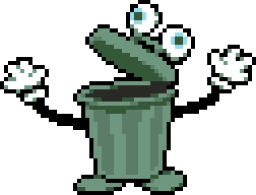

# Proyect Trashy



Modelo de reconocimiento de residuos para reciclaje. Detecta el tipo de residuo en una imagen y la app le indica al usuario en qué contenedor va. El modelo está pensado como base para futuros proyectos de automatización de reciclaje.

## Clases

El dataset se **anota** con 13 subclases (para conservar el detalle que necesitaría una planta) y el modelo v1 se **entrena** con 7 clases finales:

`plastico` · `vidrio` · `papel_carton` · `metal` · `organico` · `tetrapak` · `no_reciclable`

- Subclase -> clase final: `configs/mapeo_clases.json`
- Clase final -> rótulo del contenedor que ve el usuario: `configs/destinos.json`
- Si cambian las reglas de reciclaje, se edita un JSON: no hace falta reentrenar.

## Estructura

```
configs/      clases, mapeo y destinos
scripts/      agrupar_clases.py (13 subclases -> 7 clases)
notebooks/    entrenamiento_residuos.ipynb (Google Colab)
docs/         criterios_etiquetado.md, experimentos.md
models/       aquí NO van los modelos (ver models/README.md)
```

## Flujo de trabajo

1. **Fotos y etiquetado** en Roboflow (proyecto Object Detection) siguiendo `docs/criterios_etiquetado.md`.
2. En Roboflow, generar una **versión** del dataset (sin augmentations: Ultralytics ya las aplica).
3. Abrir `notebooks/entrenamiento_residuos.ipynb` en Google Colab, activar GPU T4 y configurar el secreto `ROBOFLOW_API_KEY`.
4. Ejecutar el notebook: descarga el dataset, lo agrupa a 7 clases, entrena YOLO11n, evalúa y exporta a TensorFlow Lite.
5. Guardar métricas en `docs/experimentos.md`; publicar versiones estables en GitHub Releases.

## Notas

- **Repo privado y Colab:** el notebook hace `git clone`. Si el repo es privado necesita un token de acceso; lo más simple es dejarlo público (no contiene datos ni modelos).
- **Dataset:** vive en Roboflow, no en git. Si el proyecto de Roboflow es público, el dataset queda en Universe bajo la licencia elegida al crearlo.
- **Licencia de YOLO:** Ultralytics distribuye YOLO11 bajo AGPL-3.0. Está bien para un proyecto académico o abierto; si algún día se comercializa un producto cerrado, hay que comprar la licencia comercial de Ultralytics o cambiar a un modelo con licencia permisiva. El dataset y estos scripts son independientes del modelo, así que se pueden reutilizar.
- **Reglas locales:** `destinos.json` es una propuesta hasta confirmar los rótulos reales de los contenedores en Panamá.
